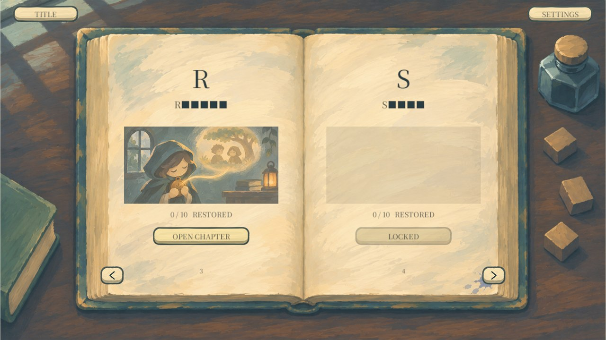
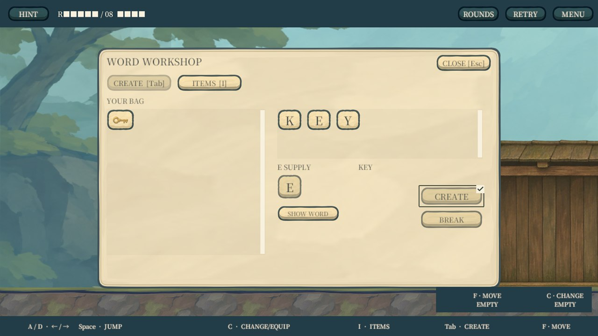
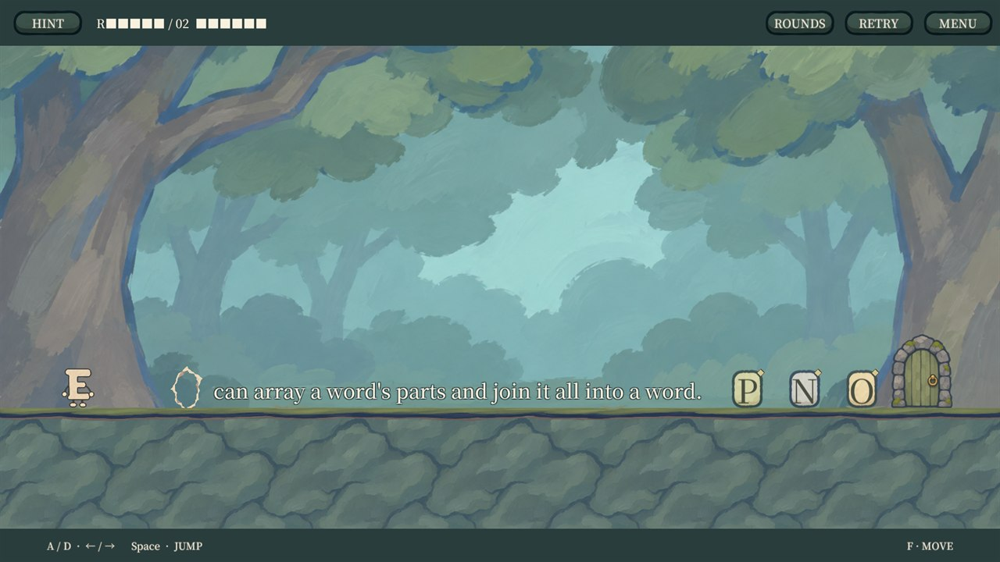
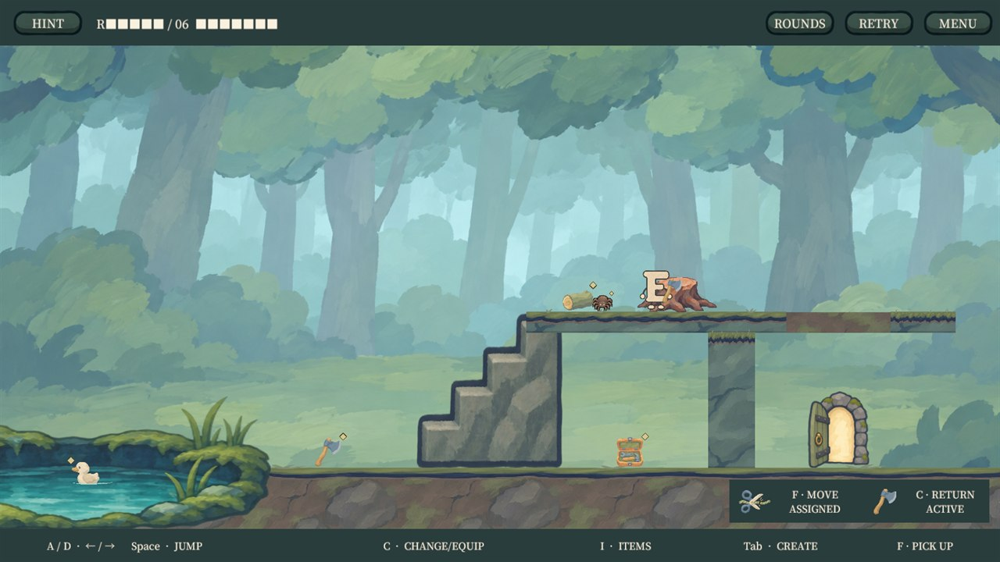
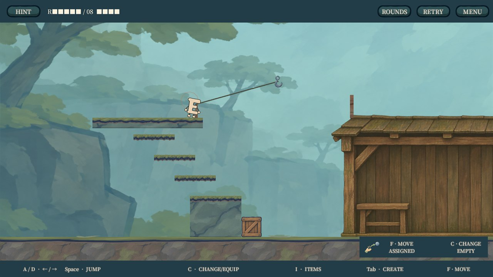
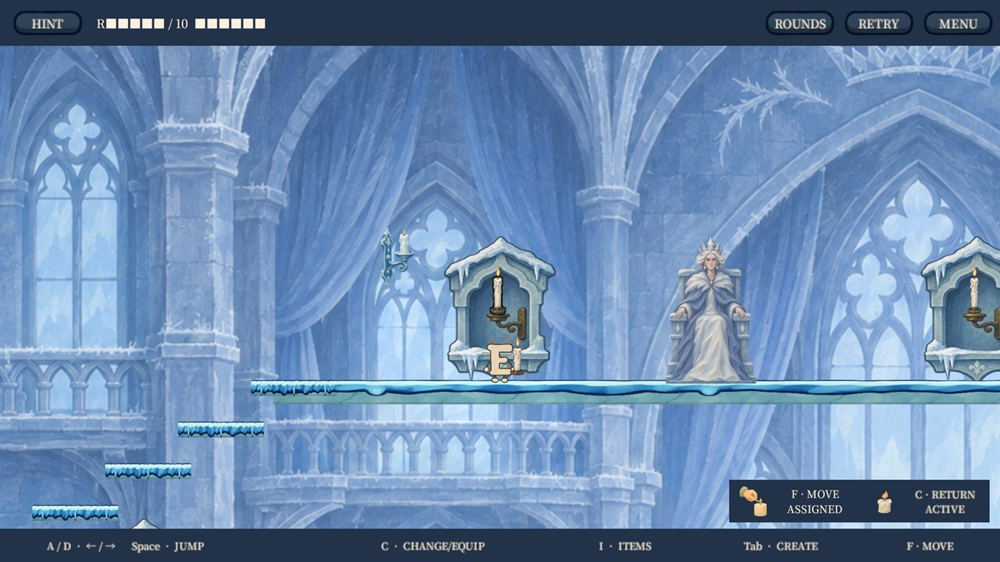

  

  <b>알파벳을 모아 단어를 만들고, 그 단어로 길을 여는 2D 퍼즐 게임</b>

  

## 게임 소개

주인공은 글자 **E**입니다. 숲과 마구간을 지나 얼음 궁전까지, 흩어진 알파벳을 주워 단어를 조립하고 그 단어를 능력과 도구로 써서 길을 엽니다.

- **조립과 분해** — 가방의 글자로 단어를 만들고(CREATE), 필요 없으면 다시 글자로 나눕니다(BREAK).
- **MOVE와 CHANGE** — 만든 단어를 MOVE 칸에 넣으면 행동이 되고, CHANGE 칸에 넣으면 변신하거나 도구를 듭니다.
- **E가 들어간 단어로 변신** — 주인공이 E이기 때문에, 변신과 장착은 E가 들어간 단어만 할 수 있습니다.

## 스크린샷

<table>
  <tr>
    <td width="50%"></td>
    <td width="50%"></td>
  </tr>
  <tr>
    <td align="center">이야기 책에서 장 고르기</td>
    <td align="center">글자를 조립해 단어 만들기 (K·E·Y → KEY)</td>
  </tr>
  <tr>
    <td></td>
    <td></td>
  </tr>
  <tr>
    <td align="center">숲에서 흩어진 글자 줍기</td>
    <td align="center">도끼를 들고 나무 베기</td>
  </tr>
  <tr>
    <td></td>
    <td></td>
  </tr>
  <tr>
    <td align="center">갈고리를 던져 마구간으로</td>
    <td align="center">얼음 궁전의 촛불 밝히기</td>
  </tr>
</table>

## 조작법

| 키 | 동작 |
| --- | --- |
| A / D, ← / → | 이동 |
| Space | 점프 |
| F | 줍기 · MOVE 단어 사용 |
| Tab | CREATE 창 (단어 조립) |
| I | ITEMS 창 (단어 장착) |
| C | CHANGE 켜기·끄기 |
| Esc | 창 닫기 |

## 실행 방법

1. [Releases](../../releases)에서 `PuzzleDemo-Win64.zip`을 받습니다.
2. 압축을 풀고 `PuzzleDemo.exe`를 실행합니다.

- Windows 64비트
- 서명되지 않은 실행 파일이라 Windows SmartScreen 경고가 뜰 수 있습니다. "추가 정보 → 실행"을 누르면 실행됩니다.

## 데모 범위

R 장 1~10층을 플레이할 수 있습니다. 다른 장은 잠겨 있습니다.
